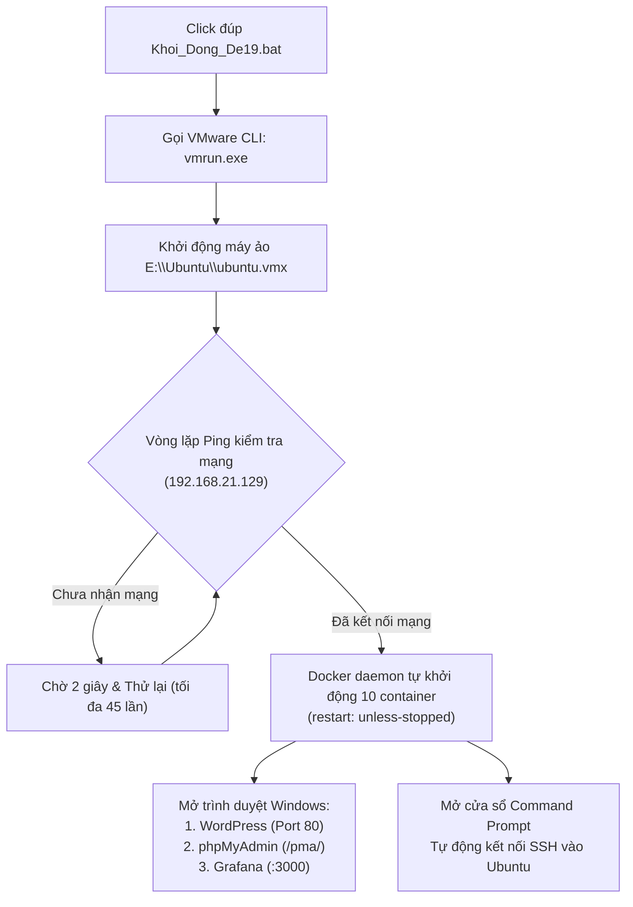

# BÁO CÁO MÔN HỌC: QUẢN TRỊ VÀ TRIỂN KHAI HỆ THỐNG PHẦN MỀM - ĐỀ 19
# HƯỚNG DẪN TỰ ĐỘNG HÓA KHỞI ĐỘNG HỆ THỐNG ĐỀ 19
**Học phần:** Triển khai và quản trị hệ thống phần mềm  
**Đề tài:** Đề 19 – Website Tin tức / Cổng thông tin  
**Sinh viên thực hiện:** Đinh Bách Hợp  
**Mã sinh viên:** DTC245201006  
**Lớp:** CNTT K23C  

---

## 1. Mục đích xây dựng tính năng

Trong quá trình bảo vệ đồ án hoặc vận hành hệ thống, việc phải thao tác thủ công nhiều bước (mở VMware Workstation, tìm máy ảo, bấm khởi động, chờ IP, gõ lệnh SSH, kiểm tra Docker, mở từng tab trình duyệt) vừa mất thời gian, vừa dễ xảy ra sai sót trước mặt hội đồng chấm thi.

Hệ thống được trang bị kịch bản khởi động **1-Click Automation** (`Khoi_Dong_De19.bat` đặt trên Desktop của máy tính Windows), giúp tự động hóa 100% quy trình từ bật máy ảo đến khởi chạy dịch vụ web và giám sát.

---

## 2. Sơ đồ quy trình tự động hóa (Workflow)

---

## 3. Kiến trúc các thành phần tự động hóa

| Thành phần | Đường dẫn / Địa chỉ | Chức năng |
| :--- | :--- | :--- |
| **Kịch bản điều khiển** | `C:\Users\ADMIN\Desktop\Khoi_Dong_De19.bat` | Script Batch điều phối toàn bộ quá trình khởi động |
| **VMware CLI Tool** | `D:\May ao\vmrun.exe` | Công cụ dòng lệnh của VMware để tương tác và bật máy ảo |
| **Tệp tin máy ảo** | `E:\Ubuntu\ubuntu.vmx` | Máy ảo Ubuntu 26.04 LTS chạy trên phân vùng SSD NVMe |
| **Mạng máy ảo (NAT)** | `192.168.21.129` | Địa chỉ IP cố định của máy ảo trong mạng VMware VMnet8 |
| **Tự kích hoạt Docker** | `systemctl enable docker` | Docker daemon tự nạp 10 container khi máy ảo vừa boot |

---

## 4. Cách sử dụng

### Khởi động hệ thống (Chỉ 1 thao tác duy nhất)
1. Bật máy tính Windows.
2. Ngoài màn hình **Desktop**, nhấp đúp chuột vào file:
   👉 **`Khoi_Dong_De19.bat`**
3. Kịch bản sẽ tự động:
   * Bật máy ảo Ubuntu.
   * Chờ mạng sẵn sàng.
   * Mở 3 tab web trên trình duyệt:
     * 🌐 Website Tin tức: `http://192.168.21.129`
     * 🗄️ Quản trị CSDL: `http://192.168.21.129/pma/`
     * 📊 Giám sát Grafana: `http://192.168.21.129:3000`
   * Bật sẵn cửa sổ Terminal kết nối thẳng SSH vào máy ảo.

---

## 5. Câu hỏi thường gặp khi bảo vệ đồ án

**Câu hỏi 1: Tại sao không cần gõ lệnh `docker compose up -d` mà các container vẫn chạy khi bật máy ảo?**  
* **Trả lời:** Trong tệp `docker-compose.yml`, tất cả các dịch vụ (WordPress, MySQL, Nginx, Prometheus, Grafana...) đều được cấu hình chỉ thị `restart: unless-stopped`. Do đó, khi dịch vụ `docker.service` của Linux khởi động cùng hệ điều hành, Docker Engine sẽ tự động phục hồi và kích hoạt toàn bộ 10 container mà không cần sự can thiệp của con người.

**Câu hỏi 2: Lệnh nào giúp Windows điều khiển được VMware Workstation?**  
* **Trả lời:** Sử dụng công cụ `vmrun.exe` chính thức do VMware cung cấp với cú pháp:  
  `vmrun.exe start "path_to_vmx" gui`  
  Công cụ này cho phép tích hợp máy ảo vào các luồng CI/CD và script tự động hóa hạ tầng (Infrastructure as Code / Scripting).
